<div align="center">

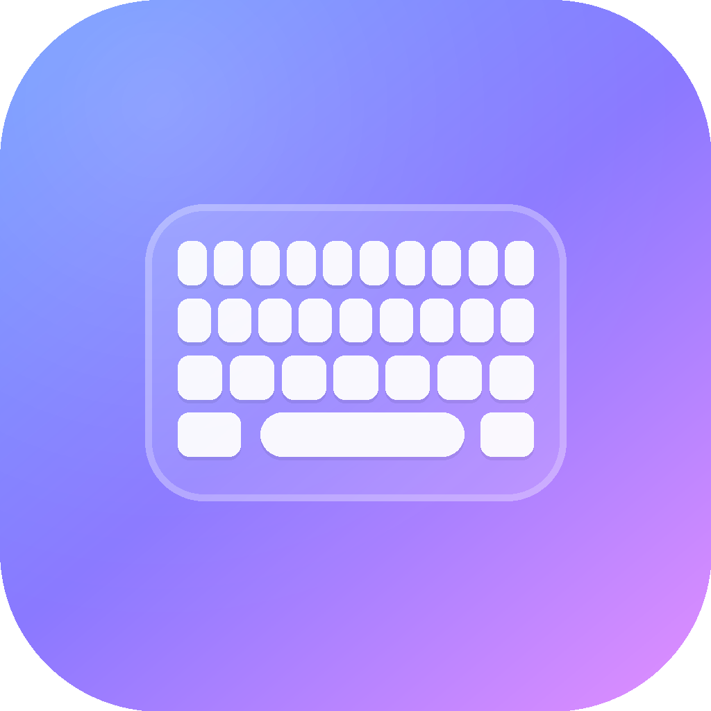

# Limbo Keyboard

**Клавиатура, которая подстраивается под вас — а не наоборот.**

[](https://kotlinlang.org)
[](app/build.gradle.kts)
[](#требования)
[](#сборка)
[](#приватность)
[](#сборка)

[Возможности](#возможности) · [Быстрый старт](#быстрый-старт) · [Настройка](#настройка) · [Сборка](#сборка) · [Под капотом](#под-капотом) · [FAQ](#faq) · [English](#english)

</div>

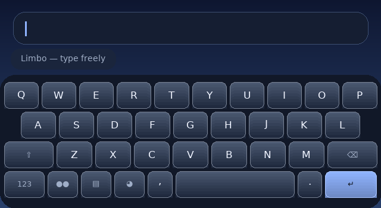

---

## Почему Limbo

Обычная клавиатура — это сетка кнопок, которая не меняется годами и требует снайперской точности.
Limbo собран вокруг трёх идей, которые чувствуются с первого жеста:

<table>
<tr>
<td width="33%" valign="top">

### Попадать не обязательно

Клавиша срабатывает, если палец рядом с ней. Чем ближе — тем увереннее выбор, а соседняя клавиша не перехватывает нажатие.

`Настройки → Раскладка → Прощающая зона`

</td>
<td width="33%" valign="top">

### Движение, а не анимация

Клавиши, панели и шторки подчиняются физике пружины: они отвечают на ваш палец, а не проигрывают заранее записанный ролик. Скорость и «характер» настраиваются.

`Настройки → Оформление → Анимации`

</td>
<td width="33%" valign="top">

### Буфер, который помнит

Скопировали адрес, ссылку или номер — они остались в истории клавиатуры. Закрепите нужное, и оно всегда под рукой, в любом приложении.

`Клавиша буфера на клавиатуре`

</td>
</tr>
</table>

> 🧊 Всё оформление — стекло, блики, тонкая зернистость и мягкие тени — рисуется на устройстве, без картинок и без единой внешней библиотеки. Тот же код работает и в приложении, и в превью на этой странице.

---

## Возможности

<details open>
<summary><b>Клавиатура</b></summary>

| | |
|---|---|
| **8 языков** | English, Русский, Deutsch, Français, Español, Italiano, Türkçe, Polski — у каждого своя привычная раскладка |
| **Прощающая зона** | Нажатие рядом с клавишей срабатывает; чувствительность регулируется ползунком |
| **Живая пружина** | Клавиша проседает под пальцем и возвращается с лёгким отскоком |
| **Увеличение под пальцем** | Удерживая букву, вы видите её крупно над клавишей — как на хороших клавиатурах |
| **Дополнительные символы** | Долгое нажатие на букву даёт акценты: `é è ê ë`, `ä ö ü`, `ё`, `ñ` и другие |
| **Свайп по пробелу** | Курсор двигается прямо по пробелу, не нужно попадать в текст |
| **Умный ввод** | Заглавная после точки, двойной пробел превращается в точку, точка в конце — по желанию |
| **Дополнительные ряды** | Ряд цифр и ряд стрелок включаются отдельно |
| **Три высоты** | Компактно, обычно, просторно — клавиши меняются целиком, а не только подписи |

</details>

<details>
<summary><b>Буфер обмена</b></summary>

- История хранит до **200** фрагментов (по умолчанию 40), а не одну последнюю копию.
- **Закрепление**: важное не вытесняется новыми копиями.
- Определяется тип: ссылка, почта, номер, многострочный текст.
- Всё происходит **на устройстве**, история переживает перезапуск.
- Последние копии неназойливо появляются в полосе над клавишами, когда нечего дополнять.

</details>

<details>
<summary><b>Внешний вид</b></summary>

- **30 готовых тем** — от спокойного инея до тёплого заката и светлой бумаги. Полная галерея ниже.
- **Студия оформления**: любой цвет фона и акцента, радиус панели и клавиш, зазор, высота клавиш, размер шрифта, разрядка, сила теней и блик — всё живьём, с мгновенным превью.
- **5 характеров клавиш**: стекло, мягкие, плотные, контур, минимал.
- **3 положения полосы подсказок**: парящая, встроенная, скрытая.
- **Свои темы** сохраняются рядом с готовыми и ведут себя так же.
- Светлая и тёмная версии любого оформления — одним переключателем.

</details>

<details>
<summary><b>Знакомство</b></summary>

Онбординг — это не экран с галочкой, а короткий разговор из восьми шагов:

1. Что это и зачем — с живой клавиатурой на экране.
2. Включение клавиатуры в системных настройках (с проверкой, что получилось).
3. Выбор клавиатуры по умолчанию.
4. Языки.
5. Раскладка и прощающая зона — с настоящей клавиатурой, которая меняется на глазах.
6. Настроение интерфейса.
7. Буфер обмена.
8. Проверка: напечатайте фразу и увидите, что попадать точно в клавишу не нужно.

Прогресс сохраняется: можно уйти на середине и вернуться.

</details>

---

## Быстрый старт

- [ ] **Установить** APK: `adb install -r dist/Limbo-debug.apk`
- [ ] **Включить**: Настройки Android → Система → Языки и ввод → Экранная клавиатура → **Limbo**
- [ ] **Выбрать**: там же, «Клавиатура по умолчанию» → **Limbo**
- [ ] **Настроить**: открыть приложение Limbo и пройти знакомство
- [ ] **Печатать** 🙂

Приложение само покажет, на каком шаге вы находитесь, и откроет нужный системный экран одной кнопкой.

---

## Настройка

Всё, что меняется, меняется сразу — без «применить» и без перезапуска.

<table>
<tr><td width="50%" valign="top">

**Клавиатура**

- высота клавиш (3 варианта)
- прощающая зона: от «строго по клавише» до «соседняя тоже считается»
- ряд цифр
- ряд стрелок и выделения
- всплывающие дополнительные символы
- задержка долгого нажатия

</td><td width="50%" valign="top">

**Ввод**

- заглавные после точки
- умный пробел
- свайп по пробелу для курсора
- подсказки слов
- двойной пробел — точка
- вибрация и звук (3 уровня вибрации)
- характер анимаций: собранные, плавные, живые, спокойные

</td></tr>
</table>

<details>
<summary><b>Полный список настроек</b></summary>

| Раздел | Настройка | Значения |
|---|---|---|
| Оформление | Тема | 30 готовых + свои |
| Оформление | Анимации | Собранные · Плавные · Живые · Спокойные |
| Оформление | Вибрация | Вкл/выкл, 3 силы |
| Оформление | Звук | Вкл/выкл |
| Настройка темы | Цвет фона (верх/низ), акцент | Любой оттенок |
| Настройка темы | Радиус панели | 8–44 |
| Настройка темы | Радиус клавиш | 2–26 |
| Настройка темы | Зазор | 2–14 |
| Настройка темы | Высота клавиш | 38–72 |
| Настройка темы | Размер шрифта | 80–125 % |
| Настройка темы | Разрядка | −0.02…0.08 |
| Настройка темы | Тени · блик · обводка | 0–100 % |
| Настройка темы | Характер клавиш | Стекло · Мягкие · Плотные · Контур · Минимал |
| Настройка темы | Полоса подсказок | Парящая · Встроенная · Скрытая |
| Ввод | Заглавные после точки | Вкл/выкл |
| Ввод | Умный пробел | Вкл/выкл |
| Ввод | Свайп по пробелу | Вкл/выкл |
| Ввод | Подсказки слов | Вкл/выкл |
| Ввод | Двойной пробел — точка | Вкл/выкл |
| Раскладка | Высота клавиш | Компактно · Обычно · Просторно |
| Раскладка | Ряд цифр · ряд стрелок · всплывающие символы | Вкл/выкл |
| Раскладка | Прощающая зона | 0–100 % |
| Раскладка | Задержка долгого нажатия | 180–700 мс |
| Языки | Набор языков | 8 языков, любое сочетание |
| Буфер | Запоминать копии · показывать в полосе | Вкл/выкл |
| Буфер | Сколько хранить | 10–200 |
| Данные | Копировать настройки, забыть слова, сбросить всё | — |

</details>

---

## Темы

Тридцать готовых наборов — и это только отправная точка: каждый цвет и радиус меняется в студии.

<table>
<tr>
<td align="center" width="20%">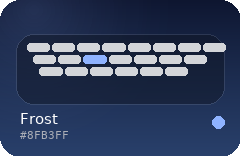<br><sub><b>Иней</b></sub></td>
<td align="center" width="20%">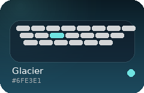<br><sub><b>Ледник</b></sub></td>
<td align="center" width="20%">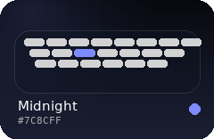<br><sub><b>Полночь</b></sub></td>
<td align="center" width="20%">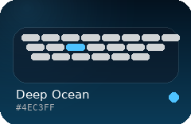<br><sub><b>Глубина</b></sub></td>
<td align="center" width="20%">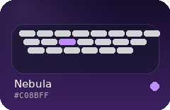<br><sub><b>Туманность</b></sub></td>
</tr>
<tr>
<td align="center">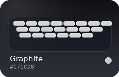<br><sub><b>Графит</b></sub></td>
<td align="center">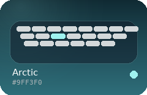<br><sub><b>Арктика</b></sub></td>
<td align="center">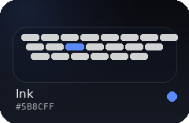<br><sub><b>Чернила</b></sub></td>
<td align="center">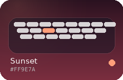<br><sub><b>Закат</b></sub></td>
<td align="center">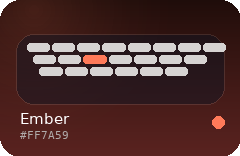<br><sub><b>Угли</b></sub></td>
</tr>
<tr>
<td align="center">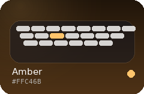<br><sub><b>Янтарь</b></sub></td>
<td align="center">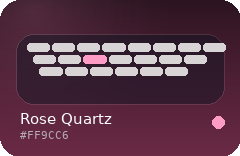<br><sub><b>Розовый кварц</b></sub></td>
<td align="center">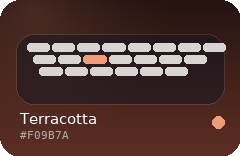<br><sub><b>Терракота</b></sub></td>
<td align="center">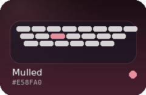<br><sub><b>Глинтвейн</b></sub></td>
<td align="center">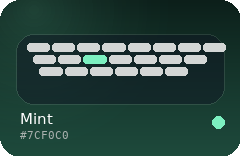<br><sub><b>Мята</b></sub></td>
</tr>
<tr>
<td align="center">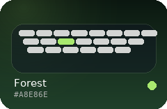<br><sub><b>Лес</b></sub></td>
<td align="center">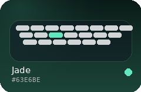<br><sub><b>Нефрит</b></sub></td>
<td align="center">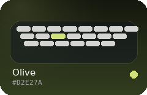<br><sub><b>Олива</b></sub></td>
<td align="center">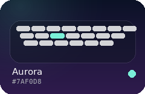<br><sub><b>Аврора</b></sub></td>
<td align="center">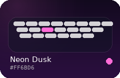<br><sub><b>Неон</b></sub></td>
</tr>
<tr>
<td align="center">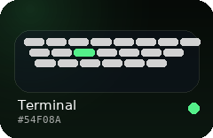<br><sub><b>Терминал</b></sub></td>
<td align="center">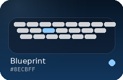<br><sub><b>Чертёж</b></sub></td>
<td align="center">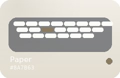<br><sub><b>Бумага</b></sub></td>
<td align="center">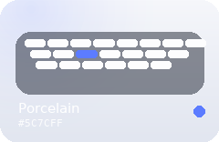<br><sub><b>Фарфор</b></sub></td>
<td align="center">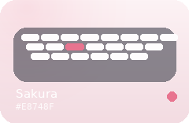<br><sub><b>Сакура</b></sub></td>
</tr>
<tr>
<td align="center">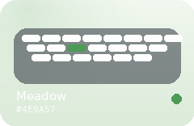<br><sub><b>Луг</b></sub></td>
<td align="center">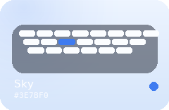<br><sub><b>Небо</b></sub></td>
<td align="center">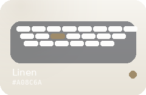<br><sub><b>Лён</b></sub></td>
<td align="center">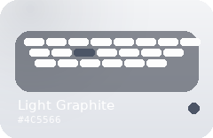<br><sub><b>Светлый графит</b></sub></td>
<td align="center">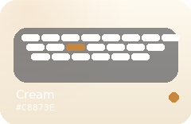<br><sub><b>Крем</b></sub></td>
</tr>
</table>

<sub>Карточки сгенерированы из тех же значений, что использует приложение: `python3 toolchain/make_docs.py`. Все темы одной картинкой — [`docs/themes.svg`](docs/themes.svg).</sub>

---

## Сборка

Два равноправных пути. Первый — привычный, второй — без Gradle вообще, когда нужен контроль над каждым шагом или сборка на машине, где Gradle недоступен.

### Требования

- JDK 17+ (`java`, `keytool` в PATH)
- Android SDK: `platforms/android-34`, `build-tools/34.0.0` (`aapt2`, `d8`, `apksigner`, `zipalign`)
- `ANDROID_HOME` или `ANDROID_SDK_ROOT`
- Для ручной сборки — ещё и Kotlin-компилятор (`kotlinc`)

### Вариант 1 — Gradle

```bash
./gradlew assembleDebug        # app/build/outputs/apk/debug/app-debug.apk
./gradlew assembleRelease      # подписанный release-вариант
./gradlew installDebug         # сразу на подключённое устройство
```

Если Gradle ещё не установлен, используйте Android Studio или `gradle wrapper` один раз.
Путь к SDK можно указать в `local.properties` (см. `local.properties.example`).

### Вариант 2 — свой сборщик, без Gradle

```bash
./toolchain/build.sh              # debug
./toolchain/build.sh --release    # release
```

Скрипт делает ровно то, что делает Gradle, но явно и по шагам:

| Шаг | Инструмент | Что происходит |
|---|---|---|
| 1 | `aapt2 compile` | ресурсы компилируются в бинарный формат |
| 2 | `aapt2 link` | ресурсы линкуются в базовый APK вместе с манифестом |
| 3 | `kotlinc` | Kotlin → JVM bytecode |
| 4 | `d8` | bytecode → `classes.dex` |
| 5 | `zip` + `zipalign` | DEX кладётся в APK, архив выравнивается |
| 6 | `apksigner` | подпись ключом из `toolchain/.keys/` (создаётся при первом запуске) |

```bash
ANDROID_HOME=~/Android/Sdk KOTLIN_HOME=/opt/kotlinc ./toolchain/build.sh
BUILD_TOOLS_DIR=~/Android/Sdk/build-tools/35.0.0 ./toolchain/build.sh   # своя версия инструментов
```

Результат — `dist/Limbo-debug.apk` (~1 МБ). Ключи и промежуточные файлы лежат вне git.

<details>
<summary><b>Что именно делает скрипт (для тех, кто повторяет руками)</b></summary>

```bash
# 1. ресурсы
aapt2 compile --dir app/src/main/res -o .work/resources.zip

# 2. манифест с package (Gradle подставляет его сам)
sed 's|<manifest |<manifest package="app.limbo.keyboard" |' \
  app/src/main/AndroidManifest.xml > .work/AndroidManifest.xml

# 3. линковка
aapt2 link -o .work/base.apk -I $ANDROID_HOME/platforms/android-34/android.jar \
  --manifest .work/AndroidManifest.xml -R .work/resources.zip \
  --java .work/gen --min-sdk-version 26 --target-sdk-version 34 \
  --version-code 1 --version-name 1.0.0

# 4. Kotlin
kotlinc $(find app/src/main/java -name '*.kt') \
  -classpath $ANDROID_HOME/platforms/android-34/android.jar:$KOTLIN_HOME/lib/kotlin-stdlib.jar \
  -jvm-target 17 -d .work/classes

# 5. DEX
(cd .work/classes && zip -q -r ../classes.jar .)
d8 --release --min-api 26 --lib $ANDROID_HOME/platforms/android-34/android.jar \
  --output .work/dex .work/classes.jar $KOTLIN_HOME/lib/kotlin-stdlib.jar

# 6. упаковка и выравнивание
cp .work/base.apk .work/unsigned.apk
(cd .work/dex && zip -q ../unsigned.apk classes.dex)
zipalign -f -p 4 .work/unsigned.apk .work/aligned.apk

# 7. подпись
apksigner sign --ks toolchain/.keys/limbo-debug.jks --ks-key-alias limbo \
  --out dist/Limbo-debug.apk .work/aligned.apk
```

</details>

---

## Под капотом

<details>
<summary><b>Структура проекта</b></summary>

```
app/src/main/java/app/limbo/keyboard/
├── core/            пружины, время, типографика, настройки, цвет
│   ├── Spring.kt        решатель пружины + общий кадровый тик
│   ├── Settings.kt      все предпочтения, мгновенная запись и подписка
│   └── Typography.kt    шкала, начертания, рисование текста с трекингом
├── layout/          языки, раскладки и модель клавиш
│   ├── Language.kt      8 языков, акценты, символьные страницы
│   └── Board.kt         построение рядов под текущее состояние
├── theme/           темы, пресеты и сериализация
├── keyboard/        сама клавиатура
│   ├── KeyboardView.kt  отрисовка, хит-тест, долгое нажатие, свайп
│   └── KeyboardEvents.kt события наружу
├── ime/             InputMethodService и панели
│   ├── LimboIME.kt      жизненный цикл, панели, шторки
│   ├── ClipboardStore.kt история буфера с закреплением
│   ├── Dictionary.kt     личный словарь подсказок
│   └── Panels.kt         буфер, эмодзи, шторка быстрых настроек
└── ui/              экраны приложения
    ├── OnboardingActivity.kt  восемь шагов знакомства
    ├── HomeActivity.kt        живая клавиатура и статус
    ├── SettingsActivity.kt    поведение и раскладка
    └── ThemeStudioActivity.kt студия оформления
```

</details>

<details>
<summary><b>Пружины вместо анимаций</b></summary>

Каждое движение — численное решение уравнения пружины:

```
a = (−k·(x − target) − c·v) / m
```

Интеграция идёт фиксированным шагом 1/240 с, поэтому пропущенный кадр не удлиняет анимацию.
Один общий `Choreographer`-цикл обслуживает все движущиеся элементы: когда всё успокоилось —
кадровый цикл останавливается сам, и клавиатура не тратит батарею в простое.

</details>

<details>
<summary><b>Как считается попадание по клавише</b></summary>

1. Точное попадание в прямоугольник клавиши — сразу она.
2. Иначе перебираются соседи в пределах «прощающей зоны»: по горизонтали она заметно шире,
   чем по вертикали (палец уходит вбок чаще, чем вверх-вниз).
3. Штраф считается по нормализованному расстоянию до края клавиши, ближайшая побеждает.
4. Если между клавишами ничья, срабатывает первая по порядку — предсказуемо для пальца.

Ширина зоны — настройка `Прощающая зона`, 0–100 %.

</details>

<details>
<summary><b>Буфер обмена</b></summary>

`ClipboardStore` подписывается на `ClipboardManager.OnPrimaryClipChangedListener`, пока
клавиатура на экране, складывает текст в локальное хранилище и переживает перезапуск.
Закреплённые записи не вытесняются, лимит (10–200) применяется только к остальным.
Тип записи определяется по содержимому: ссылка, почта, номер, многострочный текст.
Системный буфер при этом не трогается, пока вы сами не попросите скопировать запись обратно.

</details>

---

## Приватность

| Что | Где |
|---|---|
| История буфера | только на устройстве |
| Выученные слова | только на устройстве |
| Настройки и темы | только на устройстве |
| Сеть | **не используется**: нет разрешения `INTERNET` |
| Аналитика и реклама | отсутствуют |

Клавиатура не отправляет нажатия никуда. Проверить это можно в `AndroidManifest.xml`: там одно
разрешение — `VIBRATE`.

---

## FAQ

<details>
<summary><b>Клавиатура не появляется в списке — что делать?</b></summary>

Настройки Android → Система → Языки и ввод → Экранная клавиатура → включить **Limbo**.
Затем «Клавиатура по умолчанию» → **Limbo**. Приложение на главном экране открывает нужный
системный экран одной кнопкой и показывает текущий статус.

</details>

<details>
<summary><b>Есть ли предиктивный ввод и свайп-набор?</b></summary>

Подсказки слов работают на личном словаре: клавиатура запоминает слова, которые вы печатаете,
и предлагает окончания. Свайп-набора «по буквам» нет намеренно — он спорит с точностью нажатий.
Свайп по пробелу при этом двигает курсор.

</details>

<details>
<summary><b>Сколько памяти занимает?</b></summary>

APK около 1 МБ, внешних зависимостей нет. Клавиатура держит в памяти только текущую доску
клавиш и кэш статичной отрисовки.

</details>

<details>
<summary><b>Можно перенести настройки на другое устройство?</b></summary>

Настройки → Данные → «Скопировать настройки»: конфигурация попадает в буфер как JSON.
Темы хранятся там же и переносятся вместе с остальным.

</details>

<details>
<summary><b>Почему клавиатура рисуется кодом, а не из XML?</b></summary>

Стекло, блики и пружины требуют точного контроля над каждым пикселем и каждым кадром.
Холст даёт это без оверхеда и без картинок под каждую плотность экрана — и одинаково
выглядит на всех устройствах.

</details>

---

## English

<details open>
<summary><b>Limbo Keyboard in a minute</b></summary>

A modular Android keyboard built around three ideas:

- **You don't have to hit the key.** A press that lands next to a key still resolves to the closest
  one — sideways misses are forgiven more than vertical ones. The tolerance is a slider.
- **Motion is physics, not playback.** Every key, panel and sheet answers through a damped spring on
  one shared frame clock, and the clock stops when nothing moves.
- **The clipboard has memory.** Copy something and it stays in the keyboard's history — pinned items
  never get pushed out, up to 200 entries, all on device.

Plus: 8 languages with their familiar layouts, 30 presets, a full theme studio (any colour, radius,
gap, height, type scale, shadow, sheen), five key styles, word suggestions from a personal
dictionary, emoji, and an eight-step onboarding that actually teaches the keyboard.

**Install:** `adb install -r dist/Limbo-debug.apk`, then enable and select Limbo in
*Settings → System → Languages & input → On-screen keyboard*.

**Build:** `./gradlew assembleDebug`, or `./toolchain/build.sh` for the manual aapt2 → kotlinc → d8 →
zipalign → apksigner pipeline (both documented above).

**Privacy:** no network permission, no analytics, no ads.

</details>

---

## Лицензия

MIT © Limbo Keyboard. Иконка, иллюстрации и темы в `docs/` сгенерированы из исходников проекта
скриптами `toolchain/make_icons.py` и `toolchain/make_docs.py`.
